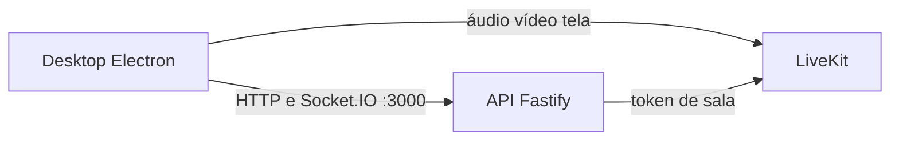

# Arquitetura

O Radcord separa três processos. O host só os coloca no ar. A API guarda contas, mensagens e presença. O LiveKit carrega áudio, vídeo e tela. O desktop é o cliente.

## Host

O script [infra/host/start-host.ps1](../infra/host/start-host.ps1) é o que `npm run host` executa.

1. Procura um adaptador Radmin ou um IPv4 `26.x`. Sem isso, para e pede o Radmin VPN.
2. Lê ou cria o segredo em `infra/host/generated/livekit-secret.txt`.
3. Grava `infra/host/generated/livekit.yaml` com o LiveKit preso a esse IP: porta `7880`, TCP `7881`, UDP `50000–50100`, `use_external_ip: false` e anúncio só da faixa `26.0.0.0/8`. O LiveKit não publica o IP público da máquina.
4. Abre `infra/host/bin/livekit-server.exe` com esse arquivo. O binário vem de `npm run host:install`.
5. Sobe a API com `BIND_HOST` no IP do Radmin, banco em `infra/host/data/radcord.db`, chave `radcord` e URL pública `ws://IP:7880`.

O script não mistura mídia. Ele não encaminha áudio nem vídeo.

`npm run host:firewall` libera no Firewall do Windows as mesmas portas, e a TCP `3000` da API, apenas para `26.0.0.0/8`.

## API

[apps/server/src/index.ts](../apps/server/src/index.ts) sobe um Fastify. A porta padrão é `3000` (`SERVER_DEFAULT_PORT`). `npm run host` define o endereço de escuta; sem `BIND_HOST`, a API escuta em `0.0.0.0`.

A API trata contas, sessão, canais e mensagens. O Socket.IO leva presença, o tempo real do chat e quem está em cada canal de voz. Para a mídia, ela só assina um token com `livekit-server-sdk` (`LiveKitTokenIssuer`) e devolve a URL pública do LiveKit. O áudio não passa por esse processo.

O mesmo servidor entrega os arquivos de atualização do desktop a partir de `infra/host/updates`.

## LiveKit

O LiveKit aqui é um servidor de mídia à parte, o executável `livekit-server`. Não é uma biblioteca embutida na API.

O desktop entra na sala com `livekit-client`. A API usa `livekit-server-sdk` só para assinar o token. Quem encaminha áudio, vídeo e compartilhamento de tela é o processo do LiveKit, no IP do Radmin.

O botão "Me ouvir" abre uma segunda conexão na mesma sala, com identidade `userId:monitor`, só para assinar o próprio microfone. O endereço é o mesmo `ws://IP:7880` que a call já usa. O que essa escuta faz, e por que ela ficava muda num PC que não é o host, está em [escuta-propria.md](escuta-propria.md).

## Quem está no canal de voz

A sala do LiveKit só existe para quem entrou na call. O cliente que está só olhando a barra não recebe os participantes por ali. A lista da barra, igual à do Discord, sai pelo gateway.

Depois que a sala conecta, o desktop emite `voice:join` com o id do canal. O host guarda um assento por usuário (canal, socket e nome) em `VoiceRoster` e publica `voice:joined` / `voice:left` para todo mundo logado. Quem abre o app no meio da call recebe `voice:snapshot` na conexão, com o estado atual.

Sair da call emite `voice:leave`. Se o app cai, o `disconnect` do socket tira o assento. O assento fica preso ao socket que entrou: fechar uma segunda janela, que só está no chat, não apaga a call. A escuta invisível (`userId:monitor`) não ocupa assento. Se a API reinicia e o LiveKit continua, o desktop reanuncia o canal quando o socket volta.

Quem está na mesma call ainda vê fala, mudo e qualidade pelo LiveKit. Quem está fora vê nome e foto. Uma queda que não fecha o TCP espera o ping do Socket.IO, na casa de dezenas de segundos, para o host perceber.

## Sons de entrar e sair

O sino não usa o roster. O roster chega para todo mundo logado, inclusive quem só olha a barra. O som sai no desktop, da sala do LiveKit em que esta pessoa está.

Entrar toca uma subida, uma vez. Quem já estava na sala não toca junto. Outra pessoa entrando ou saindo toca o som dela. Sair da call, ou cair, toca a descida. Trocar de canal toca a saída do anterior e a entrada do novo. A escuta `:monitor`, a faixa de tela e uma identidade auxiliar ficam mudas. Uma reconexão rápida do LiveKit não repete a sala inteira.

Surdo silencia esses sons pelo mesmo `deafened` da call. A chave e o volume ficam nas preferências do microfone, em Configurações → Voz. O que cada caso faz está em [sons-da-call.md](sons-da-call.md).

## Desktop

O app é Electron, em `apps/desktop`. O áudio que acompanha a tela não vem do loopback do sistema: o helper WASAPI captura o processo da janela, e o que já quebrou nessa captura está em [audio-tela.md](audio-tela.md). A voz do microfone, e por que ela saía abafada, está em [audio-microfone.md](audio-microfone.md). `npm run desktop` sobe o modo de desenvolvimento com `electron-vite`. `npm run desktop:dist` gera o instalador NSIS do Windows com `electron-builder`, em `apps/desktop/release`. `npm run desktop:publish` copia esse pacote para a pasta que a API serve.

Na 0.1.112 a lista do canal, a captura do microfone e o botão Me ouvir entram juntos. A lista mora na API: reinicie o host para ela passar a valer. O microfone e o Me ouvir moram no app: reabra o desktop nos dois PCs.

Na 0.1.113 mutar e ensurdecer passam pelo mesmo estado no desktop. Surdo cala o microfone publicado no LiveKit e o áudio que chega, inclusive o da tela. Clicar em mutar enquanto surdo liga os dois de novo. Clicar em ensurdecer de novo devolve o mute anterior. O detalhe está em [audio-microfone.md](audio-microfone.md).

Na 0.1.116 os sons de entrar e sair moram no app. Reabra o desktop nos dois PCs. O host não entra nisso.
