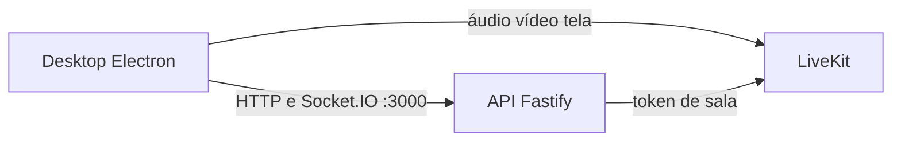

# Arquitetura

O Radcord separa três processos. O host só os coloca no ar. A API guarda contas, mensagens e presença. O LiveKit carrega áudio, vídeo e tela. O desktop é o cliente.

## Host

O script [infra/host/start-host.ps1](../infra/host/start-host.ps1) é o que `npm run host` executa.

1. Procura um adaptador Radmin ou um IPv4 `26.x`. Sem isso, para e pede o Radmin VPN.
2. Lê ou cria o segredo em `infra/host/generated/livekit-secret.txt`.
3. Grava `infra/host/generated/livekit.yaml` com o LiveKit preso a esse IP: porta `7880`, TCP `7881`, UDP `50000–50100`, `use_external_ip: false` e anúncio só da faixa `26.0.0.0/8`. O LiveKit não publica o IP público da máquina.
4. Abre `infra/host/bin/livekit-server.exe` com esse arquivo. O binário vem de `npm run host:install`.
5. Sobe a API com `BIND_HOST` no IP do Radmin, banco em `infra/host/data/radcord.db`, chave `radcord` e URL pública `ws://IP:7880`.

O script não mistura mídia. Ele não encaminha áudio nem vídeo.

`npm run host:firewall` libera no Firewall do Windows as mesmas portas, e a TCP `3000` da API, apenas para `26.0.0.0/8`.

## API

[apps/server/src/index.ts](../apps/server/src/index.ts) sobe um Fastify. A porta padrão é `3000` (`SERVER_DEFAULT_PORT`). `npm run host` define o endereço de escuta; sem `BIND_HOST`, a API escuta em `0.0.0.0`.

A API trata contas, sessão, canais e mensagens. O Socket.IO leva presença e o tempo real do chat. Para voz, ela só assina um token com `livekit-server-sdk` (`LiveKitTokenIssuer`) e devolve a URL pública do LiveKit. O áudio não passa por esse processo.

O mesmo servidor entrega os arquivos de atualização do desktop a partir de `infra/host/updates`.

## LiveKit

O LiveKit aqui é um servidor de mídia à parte, o executável `livekit-server`. Não é uma biblioteca embutida na API.

O desktop entra na sala com `livekit-client`. A API usa `livekit-server-sdk` só para assinar o token. Quem encaminha áudio, vídeo e compartilhamento de tela é o processo do LiveKit, no IP do Radmin.

## Desktop

O app é Electron, em `apps/desktop`. `npm run desktop` sobe o modo de desenvolvimento com `electron-vite`. `npm run desktop:dist` gera o instalador NSIS do Windows com `electron-builder`, em `apps/desktop/release`. `npm run desktop:publish` copia esse pacote para a pasta que a API serve.
